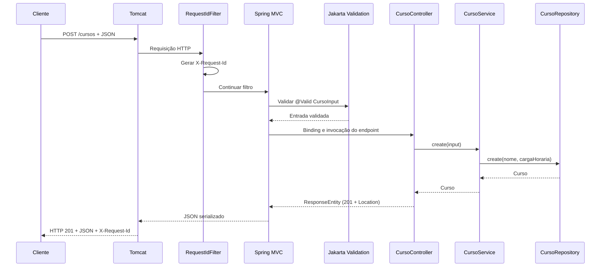

# Arquitetura

## Inicialização e dependências

`Application` é a classe `@SpringBootApplication` que inicia o contexto do Spring. A busca de componentes parte de `br.com.minispring`, cobrindo controllers, serviços, repositório e componentes web. A injeção de dependências por construtor mantém as dependências explícitas; o repositório em memória é um bean Spring singleton e usa estruturas seguras para acesso concorrente.

Spring Boot configura Spring MVC, Jackson, Jakarta Validation e o Tomcat embutido. Porta, endereço e nome da aplicação são configuráveis por `application.properties` e pelos mecanismos de configuração padrão do Spring Boot.

## Fluxo HTTP

Spring MVC resolve caminhos, métodos, query params, variáveis de caminho, corpos JSON e serialização. `@Valid` ativa as restrições Jakarta Validation no DTO de entrada. `ApiExceptionHandler` traduz erros de validação, binding, roteamento e negócio para um formato JSON comum; exceções inesperadas são registradas no log sem expor detalhes internos ao cliente.

`RequestIdFilter` gera um identificador por requisição, o devolve no header `X-Request-Id` e registra método, caminho, status e duração. O identificador também é incluído no corpo de erros.

## Camadas

- **Controller:** define o contrato HTTP: `GET /cursos` lista e filtra por nome, `GET /cursos/{id}` consulta, `POST /cursos` cria, `PUT /cursos/{id}` substitui, `PATCH /cursos/{id}` atualiza parcialmente e `DELETE /cursos/{id}` exclui. A criação retorna `201` com `Location`; exclusão retorna `204`.
- **Service:** normaliza a busca por nome sem diferenciar maiúsculas de minúsculas, apara nomes e aplica a regra de duração total entre 1 e 2000 horas.
- **Repository:** mantém os cursos em `ConcurrentHashMap`, cria IDs atômicos e ordena as listagens. Operações individuais são seguras para concorrência; não há transações.
- **DTOs:** `CursoInput` impede que o cliente escolha o ID e declara validações de criação/substituição; `CursoPatch` representa campos parciais. No PATCH, campos omitidos e campos `null` não alteram o valor existente, e um objeto vazio é aceito sem efeito.
- **Web:** `ApiExceptionHandler` formata erros segundo a RFC 9457; `RequestIdFilter` inclui `X-Request-Id`; `HttpCachingConfig` habilita ETag para GETs de `/cursos` e `/cursos/{id}`.

O armazenamento é intencionalmente volátil. O projeto não inclui banco de dados, autenticação ou autorização; a aplicação é configurada para escutar em `127.0.0.1`. `/health` apenas confirma que a aplicação responde, sem verificar dependências externas.

## Testes

`ApiIntegrationTest` inicia a aplicação em porta aleatória e exercita a API por HTTP. A suíte cobre CRUD, limites e validação, semântica do PATCH, erros estruturados, paginação, ETag/304, negociação de método HTTP e criação concorrente de IDs.
