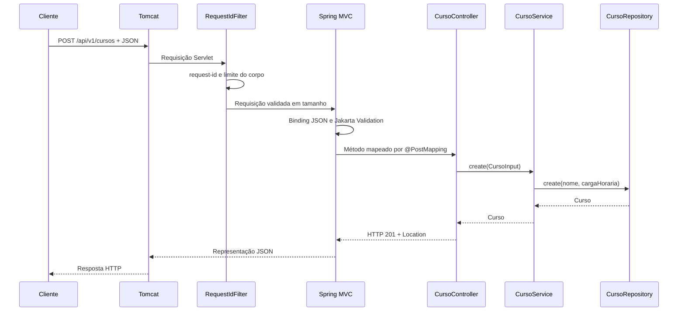

# Arquitetura da aplicação

## Spring Boot e Spring MVC

`Application` usa `@SpringBootApplication` e `SpringApplication.run` para inicializar o contexto e o servidor Tomcat embutido. Spring Boot fornece autoconfiguração, IoC/DI, roteamento MVC, binding de parâmetros, conversão JSON e integração com Jakarta Validation. Não há um container, roteador ou Servlet de despacho próprios.

O caminho de uma requisição de escrita segue as camadas:

## Responsabilidades

- **Controller** (`controller/`): declara rotas e status HTTP com anotações Spring MVC; não implementa roteamento nem serialização.
- **Service** (`service/`): aplica filtros, paginação, ordenação e regras do catálogo.
- **Repository** (`repository/`): abstrai o armazenamento de cursos.
- **In-memory repository**: guarda registros em `ConcurrentHashMap` e IDs com `AtomicLong`. O estado reinicia junto com a aplicação.
- **Model e DTO** (`model/`): records descrevem Curso, entradas, patch e página de resposta. Jakarta Validation valida DTOs HTTP.
- **Web** (`web/`): traduz falhas para o contrato JSON da API e preserva `X-Request-Id` e o limite de 1 MiB para corpos de escrita.

O armazenamento é seguro por operação concorrente; não há persistência durável, snapshot transacional ou transação de múltiplas operações.

## Contrato REST

`/api/v1/cursos` é a rota canônica, enquanto `/cursos` mantém os aliases legados. A OpenAPI estática em [`../openapi.yaml`](../openapi.yaml) é a referência formal para rotas, payloads e erros.

- POST cria recurso e retorna 201 com `Location`.
- GET lista, filtra ou consulta.
- PUT substitui os campos editáveis do Curso.
- PATCH usa JSON Merge Patch: campos omitidos permanecem, `null` e campos desconhecidos são inválidos. A entidade resultante é validada antes de ser gravada atomicamente.
- DELETE retorna 204 sem corpo.
- HEAD reaproveita GET sem corpo.
- OPTIONS explícito retorna 204 e `Allow`.
- A listagem v1 tem paginação zero-based, tamanho padrão 20/máximo 100 e ordenação estável por ID como desempate. O alias legado continua retornando array.

## Erros e validação

`ApiExceptionHandler` mapeia erros conhecidos para o contrato uniforme `{timestamp, status, message, path, details, requestId}`. Falhas inesperadas recebem 500 genérico, com detalhes apenas no log. O `RequestIdFilter` cria o ID antes do processamento MVC e limita corpos de POST/PUT/PATCH a 1 MiB, inclusive quando não há `Content-Length`.

Jakarta Validation substitui o validador artesanal anterior. A regra de negócio de no máximo 2000 horas continua no service; dados em memória e API permanecem públicos, sem autenticação.

## Testes

`ApiIntegrationTest` executa a aplicação Spring Boot com Tomcat em porta aleatória e verifica o contrato público via HTTP.

Execute `mvn clean verify` para compilar, executar os testes e empacotar o JAR executável.
